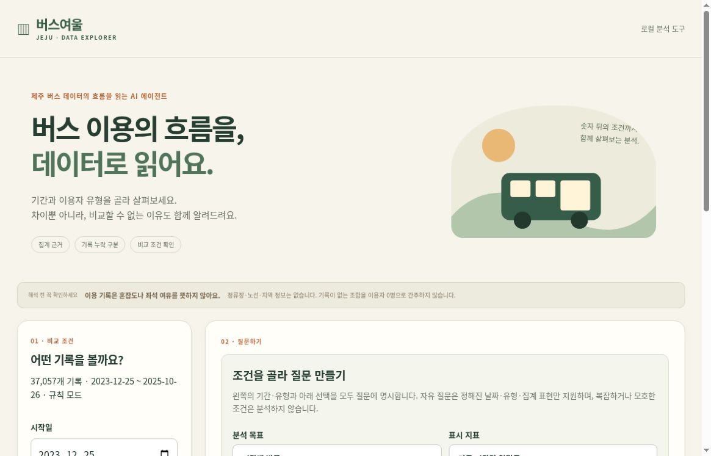
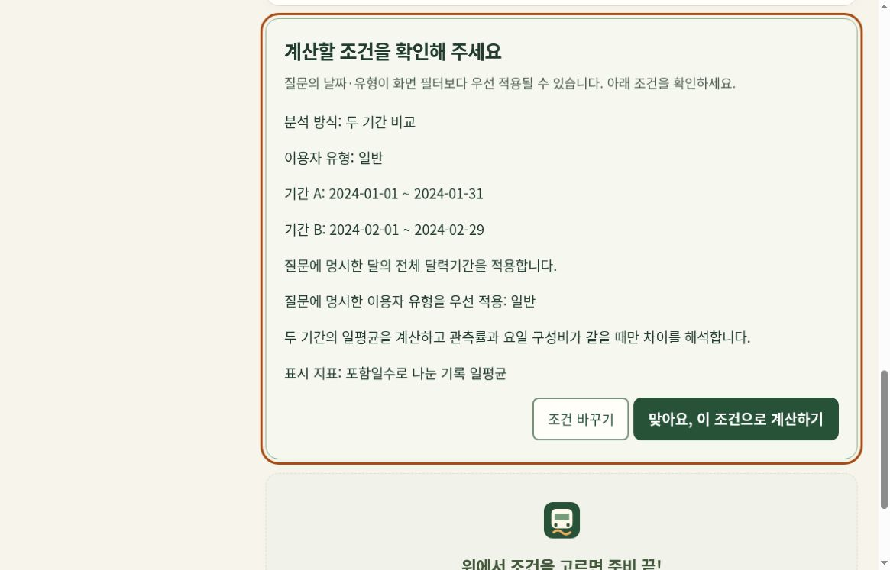
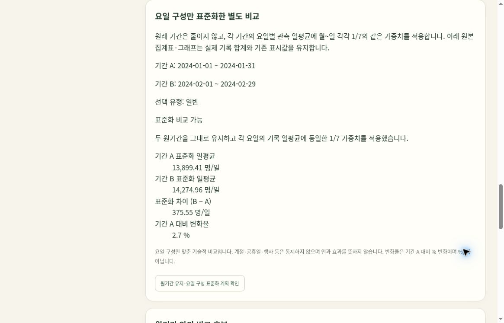

<div align="center">

# 버스여울
### 제주 버스 데이터의 흐름을 읽는 AI 에이전트

**그럴듯한 답보다, 확인할 수 있는 답.**

[빠른 시작](#빠른-시작) · [실제 화면](#실제-화면) · [기획서](output/pdf/bus-guide-proposal.pdf) · [검증 기록](docs/VALIDATION.md)

</div>

<table>
<tr>
<td width="45%"></td>
<td>
<h3>숫자의 흐름과, 숫자가 말하지 못하는 것.</h3>
<p>“지난달보다 버스를 더 많이 탔을까?”<br>달의 길이가 다르면 합계와 일평균은 서로 다른 답을 줄 수 있습니다.</p>
<p>버스여울은 질문의 조건을 먼저 확인하고, 계산 근거와 비교의 한계를 함께 보여주는 <strong>로컬 데이터 분석 도구</strong>입니다.</p>
<p><small>풍경 사진은 제주를 소개하기 위한 이미지입니다. 이 앱은 관광 코스나 노선을 추천하지 않습니다.</small></p>
</td>
</tr>
</table>

사진: [lumoplank / CC0](docs/IMAGE_CREDITS.md). 사진 제공자와 공공기관의 후원·보증을 의미하지 않습니다.

## 한눈에 보기

| 질문 | 버스여울의 답변 방식 |
|---|---|
| 언제 이용 기록이 많았을까? | 길이가 다른 시간 구간을 시간당 일평균으로 환산 |
| 두 기간을 그대로 비교해도 될까? | 날짜 수·요일 구성·관측률을 확인하고 불충분하면 비교 보류 |
| 요일 구성만 맞춰 보면 어떨까? | 원기간을 유지한 채 월~일 일평균에 같은 가중치 적용 |
| “이용이 늘었다”는 말이 맞을까? | 선택한 지표의 증가·감소 방향만 검증하고 근거 저장 |
| 기록이 없는 칸은? | 0으로 채우지 않고 미기록 상태와 해석 제한 표시 |

```text
질문 → 분석 계획 확인 → 계산 도구 → 비교 가능성 점검 → 근거 보고서
```

## 같은 기록, 다른 결론

2024년 1월과 2월, `일반` 유형을 비교한 실제 집계입니다.

| 지표 | 1월 | 2월 | 읽을 때 주의할 점 |
|---|---:|---:|---|
| 기록 합계 | 431,590 | 414,442 | 31일과 29일이므로 동일 길이의 기간이 아님 |
| 달력일 평균 | 13,922.258 | 14,291.103 | 요일 구성비가 달라 동등조건 변화 판단은 보류 |
| 요일 구성 표준화 일평균 | 13,899.414 | 14,274.964 | 요일별 평균에 각각 1/7 적용. 별도 승인 후 계산 |

요일 구성만 맞추면 차이는 **+375.550명/일(+2.702%)**입니다. 이는 기술적 비교이며 계절·공휴일·행사·정책 효과나 통계적 유의성을 뜻하지 않습니다. 승차 집계는 고유 이용자 수가 아닙니다.

## 실제 화면

아래는 실제 로컬 앱에서 확인한 화면입니다. **규칙 기반 실행**을 캡처한 것이며, AI가 생성한 화면이나 합성 데이터 결과가 아닙니다.



### 먼저 조건을 확인합니다



### 비교의 조건을 결과 옆에 남깁니다



화면의 수치는 변경하지 않았습니다. 실제 집계 자료는 `web-demo/data/bus.csv.gz`로 공개하며 출처·조건은 [데이터 안내](web-demo/data/README.md)를 참고하세요.

## 빠른 시작

**Python 3.12 권장. 기본 규칙 모드는 Python 3.10 이상에서 외부 패키지 없이 실행합니다.**

1. [원본 데이터 안내](docs/DATA.md)를 읽고, 이용 조건을 확인한 CSV를 준비합니다.
2. 저장소를 내려받고 Windows에서는 `start.bat`를 실행합니다. 다른 OS에서는 아래 명령을 사용합니다.
3. 첫 실행에서 CSV를 선택하거나 `data/bus.csv`에 둡니다. 검증한 원본 해시와 다른 파일은 실행하지 않습니다.

```bash
git clone https://github.com/dbwls99706/jeju-bus-agent.git
cd jeju-bus-agent
python launch.py
```

브라우저가 자동으로 열리지 않으면 터미널에 표시된 로컬 주소로 접속하세요. 실행 창은 유지하고 `Ctrl+C`로 종료합니다.

> 실제 CSV는 `web-demo/data/bus.csv.gz`에 압축되어 있습니다. 이를 풀어 `data/bus.csv`에 두면 로컬 규칙 분석을 실행할 수 있습니다. 모델 가중치는 포함하지 않습니다. 웹은 현재 AI를 실행하지 않으며 제출용 ZIP의 로컬 Qwen 구성과 다릅니다.

### 실제 AI 모드

Qwen2.5-1.5B-Instruct가 질문에 맞는 **제한된 분석 도구를 선택**합니다. 날짜·유형 해석, 수치 계산, 비교 가능성 점검과 주장 검증은 고정된 코드가 수행합니다. 모델이 숫자를 만들어 답하는 구조가 아닙니다.

- 기본 실행: 규칙 모드
- AI 실행: 모델 설치 후 Windows `start-ai.bat`
- 최초 설치: 인터넷과 약 3GB 모델 저장 공간, 추가 패키지·메모리 여유 필요
- 실행 중: 로컬 모델 사용, 외부 AI API 키·호출 요금 없음

자세한 설치와 지원 질문은 [사용 안내](docs/USAGE.md)를 참고하세요. [AI 활용·외부 구성요소 명세](docs/AI_AND_EXTERNAL_RESOURCES.md)에는 개발 지원과 실행 모델을 구분했습니다.

## 더 편하게 읽는 화면

18px 본문, 넉넉한 주요 버튼, 쉬운 단계 안내와 키보드 초점을 적용했습니다. 200%·400% 확대 상태에서 전체 가로 넘침을 점검했습니다. 실제 어르신 참여 시험이나 WCAG 전체 인증을 받았다는 뜻은 아닙니다. [접근성 기준과 검증 범위](docs/ACCESSIBILITY.md)

## 웹 체험판

[버스여울 웹 체험판](https://busyeoul-demo.vercel.app/)은 **실제 제주 버스 승차 집계 37,057행·규칙 모드**로 분석합니다. 현재 웹 AI는 비활성입니다. 자료는 2023-12-25~2025-10-26의 과거 집계이며 실시간 정보가 아닙니다. [출처 및 이용조건 한계](web-demo/data/README.md)를 확인하세요.

**내 CSV 로컬 분석**에서는 지원 형식의 CSV를 브라우저 안에서만 읽어 시간대·요일별 관측 합계를 확인할 수 있습니다. 파일을 서버로 보내거나 저장하지 않으며, 제출용 AI 분석 전체를 웹으로 옮긴 기능은 아닙니다. [구성과 제한](web-demo/README.md)

## 검증과 한계

| 확인한 것 | 상태 |
|---|---|
| 단위·HTTP 검사 | 205개 통과 |
| 시간·요일·유형·월 집계 | 독립 SQLite 대조 일치 |
| CSV 내보내기 | 메타데이터·미관측 상태·수식 주입 방어 검사 통과 |
| Linux 실제 브라우저 흐름 | 계획 확인·분석·표준화·주장 확인 검증 |
| 로컬 모델 실제 추론 | 제한된 내부 문항으로 확인, 외부 일반화 평가 아님 |
| Windows·센터 PC 실사용 | 미검증 |
| 모델 최초 전체 다운로드·실제 인쇄 | 미검증 |

**하지 않는 일:** 실시간 운행·혼잡도·좌석·노선·관광 코스 안내, 배차 정책 결정, 자유문장 사실 검증, 인과 효과 추론.

자료에는 노선·정류장·지역 열이 없습니다. 2025-10-26까지의 과거 기록이며, 미기록을 0명으로 간주하지 않습니다. 자연어는 정해진 날짜·유형·분석 표현만 지원하며 해석하지 못한 조건을 무시하지 않습니다.

## 자료와 권리

- **승차 자료:** 사용자 제공 `일별시간대별버스승차인원수현황.csv`, 37,057행. 실제 파일은 `web-demo/data/bus.csv.gz`에 포함합니다.
- **이용조건 근거:** [교육부·KERIS 공식 2차 메타](https://data.edmgr.kr/dataView.do?id=jejudatahub-net-512)에 CC0가 표시됩니다. 원포털의 현행 약관·첨부 버전 바이트 동일성은 직접 대조하지 못했습니다. [상세 명세](docs/DATA.md)
- **사진·화면:** [이미지 출처와 사용 범위](docs/IMAGE_CREDITS.md)
- **개발 지원·모델·의존성:** [AI 및 외부 자원 고지](docs/AI_AND_EXTERNAL_RESOURCES.md)

제주 AI·빅데이터 활용 AI Agent 개발 챌린지의 로컬 분석 프로토타입입니다. 수상·센터 실사용 검증 완료를 주장하지 않습니다.
